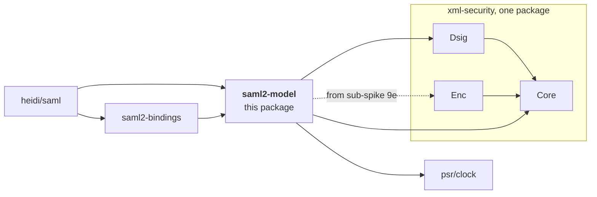

# saml2-model: specification

The SAML 2.0 model of the stack: the `samlp:`, `saml:` and `md:` objects of the Web Browser SSO and Single Logout profiles, read strictly, validated against the rules of the profiles, and written, on the safe DOM, the signatures and the encryption of `xml-security`. It reads an assertion only in what a signature covers, takes a peer's keys from its metadata only, and knows no HTTP.

| | |
|---|---|
| Repository | `beffroi-php/saml2-model` |
| Package | `beffroi-php/saml2-model` |
| Namespace | `Beffroi\Saml2\Model`, next to `Beffroi\Saml2\Bindings` of `saml2-bindings` |
| Runtime | PHP 8.4 or later; `beffroi-php/xml-security`, its `Core` and `Dsig` namespaces, and `Enc` from sub-spike 9e (section 6.7); `psr/clock` (PSR-20, section 5.2). Nothing else. |
| Consumers | `saml2-bindings`; `heidi/saml`, the module of the identity provider's monorepo, in both roles; outside the project, any identity provider or service provider written in PHP |
| Design | Sub-spike 9b of [spike 9](https://github.com/Spomky-Labs/heidi-design/blob/main/spikes/09-saml/README.md); [decision 0013](https://github.com/Spomky-Labs/heidi-design/blob/main/docs/decisions/0013-saml-formats-xml-ecrits-ici.md) (the stack writes its SAML formats), [decision 0015](https://github.com/Spomky-Labs/heidi-design/blob/main/docs/decisions/0015-xml-security-un-seul-paquet.md) (one package for XML security, SAML apart), [decision 0006](https://github.com/Spomky-Labs/heidi-design/blob/main/docs/decisions/0006-sur-par-defaut.md) (no option to do it wrong) of the identity provider's design repository |

This document states what the package does, what it refuses and what it guarantees; the code conforms to it, or the document changes first, in its own commit, with its reason. Section 4 lists the invariants every test enforces, each with the attack class it closes, section 5 the public API, section 6 the order of the rules for each message, section 9 the corpus that judges the package. The specifications of `xml-security` are cited as `core.md`, `dsig.md` and `enc.md`, their invariants as `I-n`, `D-n` and `E-n`; the invariants of this document are `M-n`.

## 1. Why this package exists

`xml-security` says whether a signature holds and what it covers. It does not know which element of a SAML message has to be signed, whose key must have signed it, to whom an assertion is addressed, when it stops being valid, which request it answers, or whether it was seen before. Every SAML bypass that is not a signature flaw is one of these.

1. **The consumer reads an element the signature does not cover.** Signature wrapping at the level of the message: a signed assertion moved into `samlp:Extensions` and an unsigned one put where the consumer looks, or a second assertion next to the signed one. Eleven of the fourteen frameworks tested in 2012 fell to it, and the class is alive in 2026 (CVE-2026-63182). `Dsig` hands back the re-parse of what it verified (D-10); the model has to read that and nothing else, and to decide which element must have been verified.
2. **The signature is optional where it matters.** The profile requires every assertion to be covered by a signature, its own or the response's (Profiles §4.1.4.5 as corrected by erratum E26). A verifier that checks the signatures present, and none that is missing, accepts an unsigned assertion in an unsigned response; one that stops at the first signature that holds ignores a second that fails.
3. **The assertion is genuine, but not for this.** Addressed to another service provider (`Audience`), delivered to another endpoint (`Recipient`, `Destination`), answering another request or none (`InResponseTo`), expired or not yet valid, presented twice. Each is a rule of the profiles (Profiles §4.1.4.2, §4.1.4.3, §4.1.4.5) that the XML Schema does not express, and that a library applies or forgets.
4. **The schema is taken for a proof.** The SAML schema allows several assertions, several confirmations and open extension points, and says nothing of what the specifications add in prose: times in UTC, absolute URIs, the length of a `NameID` per format, the condition that must be understood or else refused. A reader that takes the first `NameID`, or its `textContent`, reads what the attacker chose (the comment-split `NameID`, Duo Labs 2018).
5. **The identity provider sends the assertion where the request says.** An `AssertionConsumerServiceURL` that the service provider's metadata does not list sends the assertion to whoever wrote the request (Profiles §4.1.4.1: "Failure to do so can result in a man-in-the-middle attack").

The package answers each with a rule in code. No rule has an option that turns it off (decision 0006); a bound can be raised up to a ceiling for a documented reason, never removed.

## 2. Position



The model reaches the DOM through `Core` only: it loads with `Loader`, navigates with `Children`, reads with `Text` and `Attributes`, builds with `DocumentFactory` and the `Dom\` API under the rule of core.md §6.5 (one prefix per namespace), serializes nothing itself, and calls nothing core.md §8 bans, whose PHPStan rules this repository copies. It verifies and signs through `Dsig` only (`Verifier`, `Signer`, `VerificationKey`, `VerificationKeys`, `SigningKeyInterface`), and decrypts and encrypts through `Enc` only, from sub-spike 9e. It calls no `openssl_*` function.

It knows no HTTP (decision 0013): no `Request`, no query string, no DEFLATE, no form field, no `RelayState`. What a binding knows and a rule needs, the URL at which a message arrived, reaches the model as a string the consumer passes (`$receivedAt`). `saml2-bindings` does the rest (section 6.8).

It knows no tenant, no user, no session, no claim mapping, no key storage and no certificate issuance: `heidi/saml` does (section 6.9). A signing key is a `Dsig` `SigningKeyInterface`, so that a key management service signs without handing its key over; a peer's key is a certificate in its metadata.

## 3. Threat model

Each row is an attack class, the rule that answers it, and where the rule lives. The invariants are numbered in section 4; the corpus cases in section 9.

| Threat | Incident or source | Rule | Where |
|---|---|---|---|
| Signature wrapping at message level: the signed assertion moved into `samlp:Extensions`, `saml:Advice` or `ds:Object`, an unsigned one in its place or next to it | "On Breaking SAML" (2012), CVE-2026-63182 | Exactly one assertion, a direct child of the response; its values read from `Verified::$document` only; `Advice` refused | M-1, M-4, `ResponseValidator` |
| An unsigned assertion accepted | Profiles §4.1.4.5 and E26, applied halfway | The assertion is covered by its own signature or the response's; every signature present verifies | M-2, `ResponseValidator` |
| Key substitution | An attacker's certificate inside the message's `KeyInfo` | The keys are the peer's metadata `KeyDescriptor` ones; the message's `KeyInfo` is never read | M-3, D-7 |
| Comment-split identifier | Duo Labs 2018, CVE-2017-11428, CVE-2018-0489 | `NameID` read with `Core`'s `Text::of()` on the verified re-parse | M-12, I-12, D-10 |
| Audience confusion | An assertion issued for another service provider | Every `AudienceRestriction` holds our entity ID (Core §2.5.1.4, E46) | M-8 |
| Forwarding to another endpoint | Core §3.2.1, Bindings §3.4.5.2, §3.5.5.2 | `Destination` and `Recipient` compared, byte for byte, with the URL at which the message arrived | M-8 |
| Response injection, login CSRF | Profiles §4.1.4.3, §4.1.5 | `InResponseTo` equals the request the consumer names, or is absent when the consumer accepts an unsolicited response | M-10 |
| Replay | Profiles §4.1.4.5 | The verified assertion ID is remembered under its issuer until its bearer window closes | M-11 |
| Expired or premature assertion, stale message | Core §2.5.1.2 | Windows against the clock port with a bounded skew | M-7 |
| Assertion sent to an attacker's endpoint | Profiles §4.1.4.1 | The assertion consumer service is one the service provider's metadata lists | M-9 |
| Parser differential on values | CVE-2025-25291 and CVE-2025-25292 (ruby-saml, 2025): two readers of one document disagree | One lexical form per value, one reading model per element, order and cardinality of the schema enforced | M-5, M-6 |
| A condition not understood | Core §2.5.1.1: Indeterminate | Refused, like Invalid | M-13 |
| An assertion inside a failure | Profiles §4.1.4.2 | A response whose status is not `Success` yields nothing | M-13 |
| ID confusion across vocabularies | An assertion `ID` equal to a signature `Id` (core.md §9.2) | One ID space per document over the SAML, XML Signature and XML Encryption ID attributes | M-14 |
| Producing what the peer refuses, or what the model itself would refuse | A built tree whose serialized form differs from what was signed (core.md §6.6) | Writers build with one prefix per namespace, sign through `Signer`, and are read back by the model | M-15 |
| An identifier in the logs | Core §8.3.7: persistent identifiers MUST NOT appear in log files | Refusals name the rule and never carry a value of the message | M-16 |
| Denial of service | Counts of assertions, audiences, attributes, values, endpoints, keys | Bounds checked before iterating | M-17 |

## 4. Invariants

Each invariant is code, never a constructor option or a flag, has at least one test in the corpus of section 9, and names the attack class it closes.

- **M-1. What is read is what was verified.** Every value of an assertion that the model checks or returns comes from the `Document` of a `Verified` (D-10): the assertion's own signature, or the response's when the response's signature covers the assertion. No public method turns a `\Dom\Element` into an `Assertion`. Before any verification, the model reads two values of a received message, its `Issuer` and its `InResponseTo`, through the `Unverified*` classes, so that the consumer can choose the peer whose keys verify it; both are read again from the verified document and compared. A protocol message that no XML signature covers (section 6.8) is read from the received document through a method whose name says the binding authenticated it. Signature wrapping.
- **M-2. The signature the profile requires, and every signature present.** A response's assertion is covered by a signature, its own or the response's (Profiles §4.1.4.5, E26). A `LogoutRequest` and a `LogoutResponse` are covered by their signature or by the binding's (Profiles §4.4.4.1, §4.4.4.2); an `AuthnRequest` is, when the metadata of either party asks for signed requests (Profiles §4.1.6). Every `ds:Signature` a protocol message or an assertion carries as a direct child is verified, whatever else is signed: one that fails refuses the whole message, and none is ever skipped. Metadata is the one exception, and a named one: `MetadataReader::readTrusted()` reads metadata the consumer trusts by its channel without verifying its signature, `readSigned()` verifies it (section 6.5). Unsigned assertions, signature stripping.
- **M-3. Keys from the peer's metadata.** The keys that verify a peer's message are those of the `KeyDescriptor` elements of the peer's role whose `use` is `signing` or absent, handed to `Dsig` as `VerificationKeys`; the `KeyInfo` of a message is never read (D-7). A certificate in metadata is the notation of a key: its validity period, chain and extensions are not evaluated (Metadata Interoperability Profile §2.6.1). Key substitution.
- **M-4. One of each, found as a direct child.** Navigation is by direct children only (I-11). A response holds exactly one `saml:Assertion` as a direct child, and nothing that searches descendants exists. An assertion holds exactly one `Subject`, one `NameID` in it, one `SubjectConfirmation` of method bearer, one `Conditions`, one `AuthnStatement`, and at most one `AttributeStatement`. Zero or two, where one is required, is `MalformedMessage`, before any signature is verified. A second assertion next to the signed one.
- **M-5. The schema is code.** Each element is read in the order and with the cardinality of the SAML 2.0 schema, by one reading model per element: a child out of order, an element of a SAML namespace that the schema does not allow there, or a second occurrence of an element allowed once, is `MalformedMessage`. The closed vocabularies are enumerations and refuse any other URI: the top-level status codes (Core §3.2.2.2), the `NameID` formats (Core §8.3), the attribute name formats (Core §8.2), the confirmation method (bearer only), the bindings of an endpoint (unknown ones dropped in metadata, section 6.5). What the schema leaves open, `samlp:Extensions`, `md:Extensions` and `##other` content, is accepted and never read. What the profiles use and this package does not support is refused by name (section 8). Parser differentials, "the XSD proves nothing".
- **M-6. One lexical form per value.** `Version` is `2.0`. A time is an `xs:dateTime` in UTC with the `Z` designator (Core §1.3.3), a calendar date, no leap second, at most nine fractional digits. A boolean is one of `true`, `false`, `1`, `0` (XML Schema Part 2 §3.2.2.1), compared as a string and never cast. An `ID` and an `InResponseTo` are NCNames (I-8). A URI is absolute (Core §1.3.2, RFC 3986 §4.3) and at most 1 024 characters (Core §8.3.6). Surrounding whitespace is refused everywhere, whitespace meaning XML's `S` and every Unicode separator and control character (`\p{Z}`, `\p{Cc}`), and a URI holds none anywhere, although XML Schema collapses it for booleans and times: no producer of the interoperability targets writes it, and two readers that disagree on it are a differential. Parser differentials, loose casts.
- **M-7. Time from the clock port, windows with a bounded skew.** `now` is read once per validation from the PSR-20 clock the consumer passes. A `NotBefore` later than `now + skew` is refused; a `NotOnOrAfter`, `SessionNotOnOrAfter` or metadata `validUntil` at or before `now - skew` is refused (Core §2.5.1.2: the interval ends at `NotOnOrAfter`); an `IssueInstant` or an `AuthnInstant` later than `now + skew` is refused; a message whose `IssueInstant` is earlier than `now - maxMessageAge` is refused, the skew not added, so that one exactly `maxMessageAge` old is accepted; a bearer window that ends later than `now + maxBearerWindow` is refused. The skew and the two maxima are bounds of section 7, never switches. Expired, premature and stale messages.
- **M-8. Addressed to us, compared exactly.** The `Issuer` of a message and of an assertion is the peer's entity ID, its `Format` omitted or `entity` (Profiles §4.1.4.1, §4.1.4.2, §4.4.4.1, §4.4.4.2), without the `NameQualifier`, `SPNameQualifier` and `SPProvidedID` an entity identifier omits (Core §8.3.6), one carrying any of them being `IssuerMismatch`; every `AudienceRestriction` holds our entity ID as one of its `Audience` elements (Core §2.5.1.4 as corrected by E46), and at least one exists (Profiles §4.1.4.2); the bearer `Recipient` is the URL at which the response arrived (Profiles §4.1.4.3); the `Destination` of a message is that URL too, required when the message is signed (Bindings §3.4.5.2, §3.5.5.2) and checked whenever present (Core §3.2.1). Every comparison is `===` on the strings as read: no case folding, no trailing slash, no percent-decoding, no normalisation. Audience confusion, forwarding.
- **M-9. Sent only where the metadata says.** The assertion consumer service of an `AuthnRequest` is an `md:AssertionConsumerService` of the service provider's metadata with the HTTP-POST binding: the one whose `Location` equals the request's `AssertionConsumerServiceURL`, or whose `index` equals its `AssertionConsumerServiceIndex`, or else the default of Metadata §2.2.3; a URL or an index that the metadata does not list is `UnknownEndpoint`, and an index next to a URL or a `ProtocolBinding` is `MalformedMessage` (Core §3.4.1: mutually exclusive). The same holds for the `SingleLogoutService` a logout message is answered at. Assertion theft through the request.
- **M-10. In response to what was asked.** The consumer says what it expects: an answer to the request of a given ID, or an unsolicited response. For an answer, the `InResponseTo` of the response and of the bearer `SubjectConfirmationData` both equal that ID; for an unsolicited response, both are absent (Profiles §4.1.4.3, §4.1.5). A `LogoutResponse` answers the `LogoutRequest` the consumer names. Response injection, login CSRF.
- **M-11. Once.** After every other rule has passed, the ID of the verified assertion is remembered under its issuer's entity ID through the replay port, until the end of its bearer window plus the skew (Profiles §4.1.4.5); a pair already remembered is `Replayed`. Nothing is remembered for an assertion that failed a rule, so that an attacker cannot burn the ID of an assertion it could not have had verified. Replay.
- **M-12. `NameID` by format.** The format is one of Core §8.3, absent meaning unspecified (with the `1.1` URI of erratum E60); the value is read with `Text::of()` from the verified document, comments concatenated (I-12); it is never trimmed, and an empty value or a value with leading or trailing whitespace is refused; each format adds its own rule: `entity` is a URI of at most 1 024 characters without `NameQualifier`, `SPNameQualifier` or `SPProvidedID` (Core §8.3.6); `persistent` and `transient` are at most 256 characters (Core §8.3.7, §8.3.8); `emailAddress` is an `addr-spec` (Core §8.3.2). Comment-split identifiers, identifier confusion.
- **M-13. Fail closed.** A response whose top-level status is not `Success` carries no assertion (Profiles §4.1.4.2) and yields `UnsuccessfulResponse`, which carries the status codes and never the `StatusMessage`; a `Success` response without an assertion is malformed. A `Condition` the model does not understand makes the assertion Indeterminate, and an Indeterminate assertion is refused like an Invalid one (Core §2.5.1.1). A missing role in metadata, an unsupported element, an unknown vocabulary: each is a refusal, never a default. Failures read as successes.
- **M-14. One loader, one ID space.** Every document the model reads is loaded by a `Core` `Loader` whose ID attributes are the preset of `SamlLoader`: `ID` on the elements of the assertion, protocol and metadata namespaces, `Id` on those of XML Signature and XML Encryption, one space per document (I-8). The same loader is the `Verifier`'s and the `Signer`'s, so that the re-parse of D-10 and the reload of D-12 apply the same rules. ID confusion.
- **M-15. What is written is what is read.** Every writer builds with `DocumentFactory` and one prefix per namespace (`samlp`, `saml`, `md`, `ds`), draws each `ID` from `random_bytes()` with 160 bits (Core §1.3.4), writes times in UTC with `Z` to the second, signs through `Signer` (D-12) with an enveloped `Signature` (Core §5.4.1) after the `Issuer`, where the schema puts it (Core §2.3.3, §3.2.1), and refuses a value its own reader would refuse. The corpus reads every written document back through the validators. Producing what the peer cannot verify.
- **M-16. Refusals name the rule, never the input.** An exception says which invariant or which section refused, and never carries an ID, a `NameID`, an entity ID, a URL, an attribute value, a status message or any byte of the message (Core §8.3.7 forbids persistent identifiers in logs; I-16 and D-13 hold the same line below). Leaks through logs.
- **M-17. Bounded.** The counts and lengths of section 7 are checked before anything iterates over them; the bounds of `Core` apply to every document, and those of `Dsig` to every signature. Denial of service.

## 5. Public API

Everything below is `final`. Value objects are `readonly` with public properties and take their values through their constructor, which enforces the rules of the value itself (a `NameId` of format `persistent` refuses 257 characters whoever builds it). Every method that refuses input declares what it throws (section 5.8). This is the compatibility surface of the package; `Internal\` is outside it.

### 5.1 Loading

```php
namespace Beffroi\Saml2\Model;

use Beffroi\Xml\Core\{IdAttributes, Limits, Loader};

final class Saml
{
    public const string ASSERTION = 'urn:oasis:names:tc:SAML:2.0:assertion';
    public const string PROTOCOL = 'urn:oasis:names:tc:SAML:2.0:protocol';
    public const string METADATA = 'urn:oasis:names:tc:SAML:2.0:metadata';
    public const string VERSION = '2.0';
}

final class SamlLoader
{
    /** ID on saml:, samlp: and md: elements, Id on ds: and xenc: elements: one ID space (M-14) */
    public static function idAttributes(): IdAttributes;

    /** The Loader every class of the package, the Verifier and the Signer are given */
    public static function create(Limits $limits = new Limits()): Loader;
}
```

The consumer loads the bytes a binding decoded with `SamlLoader::create()->load($bytes)` and holds the `Document` for as long as the validation runs (core.md §6.1 step 7); a validator holds it too, through the `Unverified*` object it receives.

### 5.2 The two ports: time and replay

```php
namespace Beffroi\Saml2\Model\Port;

interface ReplayGuardInterface
{
    /**
     * Remember that the assertion $id of $issuer was accepted, atomically: two concurrent calls with the same pair
     * return true once.
     *
     * @param string             $issuer    the verified entity ID of the assertion's issuer
     * @param string             $id        the verified ID of the assertion
     * @param \DateTimeImmutable $expiresAt when the pair may be forgotten: the end of the bearer window plus the skew
     *
     * @return bool true when the pair had not been seen and is now remembered, false when it had
     */
    public function remember(string $issuer, string $id, \DateTimeImmutable $expiresAt): bool;
}
```

The clock is `Psr\Clock\ClockInterface` (PSR-20), the port `heidi/core` already reads and `symfony/clock` implements: one method, `now()`, read once per validation (M-7). The replay port is the shape of `heidi/oidc`'s `DpopProofReplayGuardInterface`, one method that answers whether the pair was new; the model compares its result to `true` and never casts it. The atomicity is the implementation's promise: a store that checks then writes lets two workers accept the same assertion. The in-memory implementations of both ports live in `tests/Support/` and are not shipped: a per-process store in a pool of workers is a replay store that forgets across workers.

```php
namespace Beffroi\Saml2\Model\Validation;

final readonly class TimeBounds
{
    /** Seconds, each between 1 and the ceiling of section 7, else \InvalidArgumentException */
    public function __construct(
        public int $clockSkew = 180,
        public int $maxMessageAge = 300,
        public int $maxBearerWindow = 3_600,
    ) {}
}
```

### 5.3 The objects

The objects of the three vocabularies, with the fields the rules of section 6 read and the writers of 5.7 write. Times are `\DateTimeImmutable` in UTC; URIs, entity IDs and identifiers are strings checked by their constructor (M-6, M-12).

| Namespace | Class | Fields |
|---|---|---|
| `Assertion` | `NameIdFormat` (enum) | the eight URIs of Core §8.3: `Unspecified`, `EmailAddress`, `X509SubjectName`, `WindowsDomainQualifiedName` (`urn:oasis:names:tc:SAML:1.1:nameid-format:*`), `Kerberos`, `Entity`, `Persistent`, `Transient` (`urn:oasis:names:tc:SAML:2.0:nameid-format:*`) |
| | `NameId` | `value`, `format`, `nameQualifier`, `spNameQualifier`, `spProvidedId` |
| | `Issuer` | `entityId`; its `Format` is written omitted, read omitted or `entity` |
| | `SubjectConfirmation` | bearer only: `recipient`, `notOnOrAfter`, `inResponseTo`, `address` |
| | `Conditions` | `notBefore`, `notOnOrAfter`, `audiences` (a list of `AudienceRestriction`, each a list of URIs), `oneTimeUse` |
| | `AuthnStatement` | `authnInstant`, `sessionIndex`, `sessionNotOnOrAfter`, `authnContextClassRef` |
| | `AttributeNameFormat` (enum) | `Unspecified`, `Uri`, `Basic` (Core §8.2) |
| | `Attribute` | `name`, `nameFormat`, `friendlyName`, `values` (a list of strings, section 6.1 step 11) |
| | `Assertion` | `id`, `issueInstant`, `issuer`, `nameId`, `confirmation`, `conditions`, `authnStatement`, `attributes` |
| `Protocol` | `StatusCode` (enum) | the four top-level codes of Core §3.2.2.2 |
| | `SecondLevelStatusCode` (enum) | the nineteen second-level codes of Core §3.2.2.2; an unknown one reads as `null` |
| | `Status` | `code`, `secondLevel`; the `StatusMessage` and `StatusDetail` are not kept |
| | `AuthnContextComparison` (enum) | `Exact`, `Minimum`, `Maximum`, `Better` (Core §3.3.2.2.1) |
| | `NameIdPolicy` | `format`, `spNameQualifier`, `allowCreate` |
| | `AuthnRequest` | `id`, `issueInstant`, `issuer`, `destination`, `assertionConsumerServiceUrl`, `assertionConsumerServiceIndex`, `protocolBinding`, `nameIdPolicy`, `forceAuthn`, `isPassive`, `requestedAuthnContext` (a `RequestedAuthnContext`: a comparison and a list of class references); `protocolBinding` is the binding's URI, checked to be HTTP-POST's in one place, since `Protocol` does not depend on `Metadata`; `NameIdPolicy::format` is one of the eight URIs of `NameIdFormat` or the `encrypted` format, `allowCreate` absent read as `false` (Core §3.4.1.1) |
| | `Response` | `id`, `issueInstant`, `issuer`, `destination`, `inResponseTo`, `status`, `assertion` (`null` on a failure) |
| | `LogoutRequest` | `id`, `issueInstant`, `issuer`, `destination`, `notOnOrAfter`, `nameId`, `sessionIndexes`, `reason` |
| | `LogoutResponse` | `id`, `issueInstant`, `issuer`, `destination`, `inResponseTo`, `status` |
| `Metadata` | `Binding` (enum) | `HttpRedirect`, `HttpPost` |
| | `Endpoint` | `binding`, `location`, `responseLocation` |
| | `IndexedEndpoint` | `binding`, `location`, `index`, `isDefault` |
| | `IndexedEndpoints` | the list, its indexes unique; `default()` (Metadata §2.2.3), `byIndex()`, `byLocation()` |
| | `IdentityProvider` | `entityId`, `signingCertificates`, `encryptionCertificates` (the base64 of each `X509Certificate`), `singleSignOnServices`, `singleLogoutServices`, `nameIdFormats`, `wantAuthnRequestsSigned`; `verificationKeys(): ?VerificationKeys` |
| | `ServiceProvider` | `entityId`, `signingCertificates`, `encryptionCertificates`, `assertionConsumerServices`, `singleLogoutServices`, `nameIdFormats`, `authnRequestsSigned`, `wantAssertionsSigned`; `verificationKeys(): ?VerificationKeys` |
| | `EntityDescriptor` | `entityId`, `validUntil`, `identityProvider`, `serviceProvider` (each `null` when the role is absent) |

`verificationKeys()` builds the `Dsig` keys from the signing certificates, `VerificationKey::fromCertificateBase64()` each, which refuses a key that is not RSA of at least 2048 bits (D-16), and returns `null` for a role without a signing certificate, since `Dsig`'s `VerificationKeys` refuses an empty list as a programming error while a peer's metadata is input: a validator that needs keys from such a role refuses the message with `SignatureRequired`, naming M-3.

### 5.4 Reading before verifying

```php
namespace Beffroi\Saml2\Model\Protocol;

use Beffroi\Xml\Core\Document;

final readonly class UnverifiedResponse
{
    /**
     * The root checked to be samlp:Response; its Issuer, or the Issuer of its one direct saml:Assertion child when it
     * has none, and its InResponseTo, read and nothing else: what the consumer needs to choose the peer (M-1).
     *
     * @throws MalformedMessage when the root is another element, an Issuer is repeated (M-4), or the two values are
     *                          not of their lexical form (M-6)
     * @throws \Beffroi\Xml\Core\Exception\MixedContent when the Issuer holds an element
     */
    public static function of(Document $document): self;

    public Document $document;
    public ?string $issuer;
    public ?string $inResponseTo;
}
```

Two `Issuer` where one is read, the response's or its assertion's, are refused (`MalformedMessage`, M-4) rather than one of them picked; a response without an `Issuer` of its own and with several assertions names no issuer (`null`), and section 6.1 step 2 refuses it. `of()` declares no `ForeignNode`: a `Document` comes from `Core`'s `Loader` or `DocumentFactory` only, so a document `Core` did not produce cannot reach it through the public API, and the `Verifier` checks the ownership of what it verifies (dsig.md §6.1 step 1).

`UnverifiedAuthnRequest`, `UnverifiedLogoutRequest` and `UnverifiedLogoutResponse` are the same for the three other roots, each exposing its `issuer` and, for the logout response, its `inResponseTo`. The values of an `Unverified*` object choose a peer and nothing else: the validators read them again from what was verified.

### 5.5 Validating, service provider side

```php
namespace Beffroi\Saml2\Model\Validation;

use Beffroi\Saml2\Model\Metadata\IdentityProvider;
use Beffroi\Saml2\Model\Port\ReplayGuardInterface;
use Beffroi\Saml2\Model\Protocol\UnverifiedResponse;
use Beffroi\Xml\Core\Loader;
use Psr\Clock\ClockInterface;

final readonly class ExpectedResponse
{
    /** A response to the AuthnRequest $requestId, received at $receivedAt (the URL of our assertion consumer service), for $audience (our entity ID) */
    public static function toRequest(string $requestId, string $receivedAt, string $audience): self;

    /** An unsolicited response (Profiles §4.1.5): InResponseTo absent everywhere */
    public static function unsolicited(string $receivedAt, string $audience): self;
}

final readonly class ResponseValidator
{
    public function __construct(
        private Loader $loader,                  // SamlLoader::create(), the Verifier's too (M-14)
        private ClockInterface $clock,
        private ReplayGuardInterface $replay,
        private TimeBounds $bounds = new TimeBounds(),
    ) {}

    /**
     * @throws MessageRefused one of its subclasses, naming the rule (M-16)
     * @throws \Beffroi\Xml\Core\Exception\RefusedXml what Core and Dsig refuse, as they refuse it
     */
    public function validate(UnverifiedResponse $response, IdentityProvider $idp, ExpectedResponse $expected): AcceptedAssertion;
}

enum SignatureCoverage
{
    case Assertion;             // the assertion's own signature, the response unsigned
    case Response;              // the response's signature, the assertion unsigned
    case AssertionAndResponse;
}

final readonly class AcceptedAssertion
{
    public function __construct(
        public string $responseId,              // from the verified response when it is signed, from the received one otherwise (6.1 step 6)
        public Assertion $assertion,
        public SignatureCoverage $coverage,
    ) {}
}
```

The consumer reads `AcceptedAssertion` and never the document again: the values are copied out of the verified document, so that nothing of the result depends on a `Document` being held.

### 5.6 Validating requests, and metadata

```php
namespace Beffroi\Saml2\Model\Validation;

enum Authentication
{
    case XmlSignature;   // a ds:Signature of the message, verified here
    case Binding;        // the binding's signature, verified by saml2-bindings (section 6.8)
    case None;           // an AuthnRequest that no party's metadata asks to be signed
}

final readonly class AuthnRequestValidator
{
    public function __construct(private Loader $loader, private ClockInterface $clock, private TimeBounds $bounds = new TimeBounds()) {}

    /**
     * The request as it arrived over HTTP-POST, or over HTTP-Redirect without a signature: a ds:Signature child is
     * verified with $sp's keys (M-2); none is accepted only when neither $sp nor $self asks for signed requests.
     *
     * @param string $receivedAt the URL of our SingleSignOnService at which the request arrived
     */
    public function validate(UnverifiedAuthnRequest $request, ServiceProvider $sp, IdentityProvider $self, string $receivedAt): AcceptedAuthnRequest;

    /**
     * The request as it arrived over HTTP-Redirect with a signature over its query string, which saml2-bindings
     * verified with Verifier::verifyDetached() under $sp's keys before calling: the caller asserts it. A ds:Signature
     * child is refused (Bindings §3.4.4.1 removes it before encoding).
     */
    public function validateAuthenticatedByBinding(UnverifiedAuthnRequest $request, ServiceProvider $sp, IdentityProvider $self, string $receivedAt): AcceptedAuthnRequest;
}

final readonly class AcceptedAuthnRequest
{
    public function __construct(
        public AuthnRequest $request,
        public IndexedEndpoint $assertionConsumerService,   // resolved from $sp's metadata (M-9)
        public Authentication $authentication,
    ) {}
}
```

`LogoutRequestValidator` and `LogoutResponseValidator` have the same two methods, with `IdentityProvider|ServiceProvider $peer` in place of `$sp`, our own entity ID, the URL of our `SingleLogoutService` at which the message arrived, and, for the response, the ID of the `LogoutRequest` it answers; `validate()` refuses a message without a `ds:Signature` (`SignatureRequired`, Profiles §4.4.4.1, §4.4.4.2), and they return `AcceptedLogoutRequest` and `AcceptedLogoutResponse`.

```php
namespace Beffroi\Saml2\Model\Metadata;

final readonly class MetadataReader
{
    public function __construct(private Loader $loader, private ClockInterface $clock, private TimeBounds $bounds = new TimeBounds()) {}

    /** Metadata the consumer trusts by the channel it came through (an administrator's upload, a pinned URL over TLS): a ds:Signature is not verified here, the consumer said why */
    public function readTrusted(Document $document): EntityDescriptor;

    /** Metadata signed by a key the consumer pinned: the signature is verified (M-2), the descriptor read from Verified::$document (M-1) */
    public function readSigned(Document $document, VerificationKeys $keys): EntityDescriptor;
}
```

### 5.7 Writing

```php
namespace Beffroi\Saml2\Model\Writing;

use Beffroi\Xml\Dsig\{SignatureAlgorithm, SigningKeyInterface};

final readonly class Signing
{
    public function __construct(
        public SigningKeyInterface $key,
        public SignatureAlgorithm $algorithm = SignatureAlgorithm::RsaSha256,
        #[\SensitiveParameter] public ?string $certificatePem = null,   // the KeyInfo hint of D-17, for peers that want it
    ) {}
}

enum SignedParts
{
    case Assertion;              // the default: the assertion signed, the response not
    case AssertionAndResponse;   // the assertion signed, then the response over it
}
```

| Writer | Method | Writes |
|---|---|---|
| `AuthnRequestWriter` | `write(AuthnRequest $request, ?Signing $signing): Document` | the request, signed when `$signing` is given; unsigned for HTTP-Redirect, whose binding signs (section 6.8) |
| `ResponseWriter` | `write(Response $response, Signing $signing, SignedParts $parts = SignedParts::Assertion): Document` | the response with its signed assertion, the response signed too on request |
| | `writeFailure(Response $response, ?Signing $signing): Document` | a response whose status is not `Success`, without assertion (Profiles §4.1.4.1) |
| `LogoutRequestWriter`, `LogoutResponseWriter` | `write(LogoutRequest\|LogoutResponse $message, ?Signing $signing): Document` | the message, signed for HTTP-POST, unsigned for HTTP-Redirect |
| `MetadataWriter` | `write(EntityDescriptor $descriptor, ?Signing $signing): Document` | an `md:EntityDescriptor` with the roles it holds, signed on request, the `Signature` its first child |

The objects carry their `ID`: `SamlId::generate()` draws it (M-15), and the consumer keeps the `ID` of a request to name it later in `ExpectedResponse::toRequest()`. A writer returns a `Document`; serializing it is `Core`'s `Serializer`, called by the binding.

### 5.8 Exceptions

```php
namespace Beffroi\Saml2\Model\Exception;

use Beffroi\Xml\Core\Exception\RefusedXml;

abstract class MessageRefused extends RefusedXml {}

final class MalformedMessage extends MessageRefused {}        // M-4, M-5, M-6: the structure or a lexical form
final class Unsupported extends MessageRefused {}             // section 8: refused by name
final class SignatureRequired extends MessageRefused {}       // M-2
final class IssuerMismatch extends MessageRefused {}          // M-8
final class AudienceMismatch extends MessageRefused {}        // M-8
final class RecipientMismatch extends MessageRefused {}       // M-8
final class DestinationMismatch extends MessageRefused {}     // M-8
final class UnknownEndpoint extends MessageRefused {}         // M-9
final class InResponseToMismatch extends MessageRefused {}    // M-10
final class Replayed extends MessageRefused {}                // M-11
final class InvalidNameId extends MessageRefused {}           // M-12
final class IndeterminateCondition extends MessageRefused {}  // M-13
final class UnsuccessfulResponse extends MessageRefused {}    // M-13, carries the Status as a public readonly property
final class OutsideValidityWindow extends MessageRefused {}   // M-7, the window named
final class LimitExceeded extends MessageRefused {}           // M-17, the bound named
```

A value object refuses with the exception of its rule whoever builds it, a reader or a writer: a `NameId` too long is `InvalidNameId` and a time outside the lexical form `MalformedMessage`, even when a writer builds them, since the value would be refused on the way back (M-15). A `MessageRefused` is input the package refuses. It extends `Core`'s `RefusedXml`, as `Dsig`'s and `Enc`'s refusals do, so that a consumer that catches that base class catches everything the stack refuses; the validators let the refusals of `Core` and `Dsig` through as they are, so that `DigestMismatch` stays `DigestMismatch`. A `\LogicException` or `\InvalidArgumentException` is a programming error of the caller (a `TimeBounds` over its ceiling, an `IdentityProvider` without a single sign-on service given to a writer) and is never caught by the stack. Messages follow M-16: they end with the rule in parentheses, `(M-8)` or `(section 8)`.

## 6. Processing rules

### 6.1 A response, service provider side, in order

`ResponseValidator::validate($response, $idp, $expected)`, `now` read once from the clock:

1. **The root.** `UnverifiedResponse::of()` checked that the root is `samlp:Response` and read the two unverified values (M-1). The consumer chose `$idp` with them, or with the state it keeps for the request of `$expected`.
2. **The structure of the envelope.** The children of the response, in the order of the schema: `saml:Issuer` optional, `ds:Signature` optional, `samlp:Extensions` optional and never read, `samlp:Status`, then the assertions. A `saml:EncryptedAssertion` is `Unsupported` until sub-spike 9e (section 6.7). With a status of `Success`, exactly one `saml:Assertion` child, else `MalformedMessage` (M-4, M-13); with another status, none. Nothing is verified yet: a document with two assertions is refused before any key is touched.
3. **The response's signature.** Whatever the status, the response's `ds:Signature`, when present, is verified: `Verifier::verify($root, $idp->verificationKeys())`, and the response is read from `Verified::$document` of that verification from here on. A signature that fails is `Dsig`'s refusal.
4. **A failure.** With a status other than `Success`, the envelope rules of step 6 run, then `UnsuccessfulResponse`, which carries the `Status` (M-13). An unsigned failure is reported as such: a failure that an attacker forges denies a login, it grants none.
5. **The assertion's signature.** The assertion's `ds:Signature`, when present, is verified on the one `saml:Assertion` child of the received root, the element the response's signature covered when there is one (M-4), and the assertion is read from that verification; one that fails is `Dsig`'s refusal, even under a response signature that held. It is never verified inside the response's `Verified::$document`: that re-parse holds only the declarations the response's exclusive form rendered, and an assertion signed with a `PrefixList` naming a prefix declared above it would lose it there and fail its digest. An assertion without a signature is read from the response's `Verified::$document`, as the one `saml:Assertion` child of its root. When neither the response nor the assertion carries a signature, `SignatureRequired` (M-2). Before the assertion's signature is verified, its place is checked on the received element: one `ds:Signature` at most (M-4), the child right after the `Issuer` (M-5, Core §5.4.1). The verification removes the signature it verified from the document it hands over (D-10), where the reader of steps 7 to 11 could no longer see one out of its place.
6. **The envelope.** Read from the verified response when it was signed, from the received one otherwise, where these values decide nothing the assertion's own rules do not decide again. `Version` is `2.0`, `ID` an NCName, `IssueInstant` within the window of M-7; `Destination` is required when the response is signed and equal to `$expected`'s URL whenever present (M-8); `Issuer` is required when the response is signed (Profiles §4.1.4.2 as corrected by E17), and when present is `$idp`'s entity ID with its format omitted or `entity` and no qualifier (M-8); `InResponseTo` follows M-10.
7. **The assertion's header.** From the verified assertion: `Version` `2.0`, `ID` an NCName, `IssueInstant` not later than `now + skew`, `Issuer` present, `$idp`'s entity ID, format omitted or `entity`, no qualifier (M-8), and equal to the response's `Issuer` when that one is present (E26), which follows from both being compared with `$idp`'s entity ID. `saml:Advice` is `Unsupported`.
8. **The subject.** One `saml:Subject` holding one `saml:NameID` read under M-12 (`saml:BaseID` and, until 9e, `saml:EncryptedID` are `Unsupported`) and one `saml:SubjectConfirmation` whose `Method` is `urn:oasis:names:tc:SAML:2.0:cm:bearer` (holder-of-key and sender-vouches are `Unsupported`), without an identifier of its own (a `saml:NameID`, `saml:BaseID` or `saml:EncryptedID` in the confirmation is `Unsupported`). Its `SubjectConfirmationData` is required and holds no element (`Unsupported`: that content is where holder-of-key puts its `ds:KeyInfo`, Core §2.4.1.3, not an extension point, and no target sends any for a bearer confirmation), a `Recipient` equal to `$expected`'s URL (`RecipientMismatch`), a `NotOnOrAfter` in the window of M-7 and at most `maxBearerWindow` ahead, no `NotBefore` (Profiles §4.1.4.2), an `InResponseTo` under M-10, and an optional `Address`, returned, never checked here.
9. **The conditions.** One `saml:Conditions`, required: its `NotBefore` and `NotOnOrAfter` in the window of M-7, the first earlier than the second when both are present (Core §2.5.1.2); at least one `saml:AudienceRestriction`, every one holding `$expected`'s audience (`AudienceMismatch`); at most one `saml:OneTimeUse`, which the replay rule of step 13 already honours; `saml:ProxyRestriction` is `Unsupported` (section 8): Core §2.5.1.6 holds it always valid, a condition on the use of the assertion that forbids or bounds re-issuing on its basis, and the identity provider re-issues on the basis of every assertion it accepts (OpenID Connect tokens to its clients, SAML assertions to its own service providers), so it refuses what it would have to honour; any other child, a `saml:Condition` of any `xsi:type` included, is `IndeterminateCondition` (M-13): inside `saml:Conditions`, an element the model does not know is a condition it does not understand, the one place where M-13's refusal takes the place of M-5's.
10. **The authentication statement.** One `saml:AuthnStatement`: `AuthnInstant` not later than `now + skew`, `SessionNotOnOrAfter` in the window of M-7 when present, `SessionIndex` returned, `saml:SubjectLocality` accepted and not read, `saml:AuthnContext` holding one `saml:AuthnContextClassRef`, a URI, its `saml:AuthenticatingAuthority` elements accepted and not read; `saml:AuthnContextDecl` and `saml:AuthnContextDeclRef` are `Unsupported`. `saml:AuthzDecisionStatement` and any other statement are `Unsupported`.
11. **The attributes.** At most one `saml:AttributeStatement`; each `saml:Attribute` has a `Name`, read as a string whatever its `NameFormat` says (SimpleSAMLphp 2.5.3.1 names `uid` under the `uri` format, section 13), a `NameFormat` of Core §8.2 or none, an absent one read as `Unspecified` (Core §2.7.3.1), an optional `FriendlyName`, and its `saml:AttributeValue` children, each read with `Text::of()`. A name repeated is accepted, as Keycloak 26.7.4 sends six `saml:Attribute` named `Role` with one value each (`tests/Interop/keycloak/README.md`): each `Attribute` is kept as read, in document order, and never merged by the model, since merging them is the consumer's decision. An `xsi:type` on a value is text, compared as text when it is compared at all, and its prefix is never resolved: the declaration it names is not covered by the signature (dsig.md §6.3). A value with an element child is refused by `Core` (`MixedContent`, section 12). `saml:EncryptedAttribute` is `Unsupported`.
12. **The bounds.** Every count of section 7 was checked where its list was read.
13. **Replay.** `$this->replay->remember($issuer, $assertionId, $notOnOrAfter + skew)` with the verified values, the bearer `NotOnOrAfter` of step 8; anything but `true` is `Replayed` (M-11).
14. **The result.** `AcceptedAssertion`, its values copied out of the verified documents.

Steps 2, 3 and 5 order the costs as `Dsig` does (D-6): the structure and the counts before any signature, a signature before any value is trusted.

### 6.2 An authentication request, identity provider side, in order

`AuthnRequestValidator::validate()` and `validateAuthenticatedByBinding()`:

1. **The root and the structure.** `samlp:AuthnRequest`, its children in the order of the schema: `saml:Issuer` required (Profiles §4.1.4.1), `ds:Signature` optional, `samlp:Extensions` never read, `samlp:NameIDPolicy` optional, `samlp:RequestedAuthnContext` optional. `saml:Subject`, `saml:Conditions` and `samlp:Scoping` are `Unsupported` (section 8).
2. **The signature.** `validate()`: a `ds:Signature` child is verified with `$sp->verificationKeys()` and the request read from `Verified::$document`; without one, the request is accepted only when neither `$sp->authnRequestsSigned` nor `$self->wantAuthnRequestsSigned` is true (`SignatureRequired`), and the result says `Authentication::None`. `validateAuthenticatedByBinding()`: a `ds:Signature` child is `MalformedMessage`, and the result says `Authentication::Binding`.
3. **The header.** `Version`, `ID`, `IssueInstant` under M-7 (not later than `now + skew`, not older than `maxMessageAge`); `Destination` required when the request carries a signature, XML or binding, and then equal to `$receivedAt`, which must be one of `$self`'s single sign-on services (`DestinationMismatch`); `Issuer` equal to `$sp`'s entity ID, format omitted or `entity` (`IssuerMismatch`). `$receivedAt` is one of `$self`'s single sign-on services on every request, `Destination` present or not (`DestinationMismatch`); an `IssueInstant` exactly `maxMessageAge` old is accepted, one second older refused.
4. **The assertion consumer service.** Resolved in `$sp->assertionConsumerServices` under M-9. `ProtocolBinding`, when present, is HTTP-POST (`Unsupported` otherwise: the Redirect binding cannot carry a response, the Artifact binding is out of scope).
5. **The rest.** `ForceAuthn` and `IsPassive` under M-6; `NameIDPolicy`'s `Format` one of Core §8.3 or the `encrypted` format of Core §3.4.1.1, returned, never enforced here: whether the identity provider can satisfy it is `heidi/saml`'s, which answers with a failure status (Profiles §4.1.4.1); the same for `RequestedAuthnContext`. `AttributeConsumingServiceIndex` and `ProviderName` are not read.
6. **The result.** `AcceptedAuthnRequest`. What happens after, a login, a failure response to the resolved endpoint, is the consumer's.

A request refused by this method gets no SAML answer: its endpoint is not established, and an answer sent to an endpoint the request named would be the theft M-9 closes.

### 6.3 A logout request, both sides, in order

`samlp:LogoutRequest`: `saml:Issuer` required (Profiles §4.4.4.1), `ds:Signature`, `samlp:Extensions`, then one `saml:NameID` (M-12; `saml:BaseID` and, until 9e, `saml:EncryptedID` are `Unsupported`), then the `samlp:SessionIndex` elements, bounded (section 7). The signature rule of M-2: `validate()` requires a `ds:Signature` and verifies it, `validateAuthenticatedByBinding()` refuses one. `Version`, `ID`, `IssueInstant` and `Destination` as in 6.2 step 3, `Destination` against our `SingleLogoutService`; `NotOnOrAfter`, when present, under M-7; `Reason` a URI, returned. Whether the `NameID` and the session indexes name a session is `heidi/saml`'s (Core §3.7.3).

### 6.4 A logout response, in order

`samlp:LogoutResponse`: `saml:Issuer` required (Profiles §4.4.4.2), `ds:Signature`, `samlp:Extensions`, `samlp:Status`. The signature rule of 6.3; `Version`, `ID`, `IssueInstant`, `Destination` as in 6.3; `InResponseTo` equal to the `LogoutRequest` the consumer names (M-10). A status other than `Success`, `urn:oasis:names:tc:SAML:2.0:status:PartialLogout` as second level included, is returned in `AcceptedLogoutResponse`, not thrown: a partial logout is an answer, and the request it answers was ours.

### 6.5 Metadata, in order

`MetadataReader::readTrusted()` and `readSigned()`:

1. **The root.** `md:EntityDescriptor`; `md:EntitiesDescriptor` is `Unsupported` (aggregated metadata, section 11). `entityID` a URI of at most 1 024 characters (M-6).
2. **The signature.** `readSigned()` verifies the `ds:Signature`, the first child, with the pinned keys and reads the rest from `Verified::$document`; `readTrusted()` does not read it.
3. **The validity.** `validUntil`, when present, under M-7; `cacheDuration` is not read: how long to cache is `heidi/saml`'s.
4. **The roles.** At most one `md:IDPSSODescriptor` and one `md:SPSSODescriptor` whose `protocolSupportEnumeration` lists `urn:oasis:names:tc:SAML:2.0:protocol`; a role that does not list it is ignored, a second role of one kind is `MalformedMessage`. Every other role descriptor, `md:RoleDescriptor` of any `xsi:type` included (Entra's metadata of core.md §9.4 carries two), and `md:Organization`, `md:ContactPerson`, `md:AdditionalMetadataLocation`, `md:AffiliationDescriptor`, are skipped. Inside a role that is read, the other children the schema allows there are skipped too, in their place of its order, not refused: `md:ArtifactResolutionService`, `md:ManageNameIDService`, `md:NameIDMappingService`, `md:AssertionIDRequestService`, `md:AttributeProfile`, an identity provider's `saml:Attribute`, a service provider's `md:AttributeConsumingService`. They are schema-valid, and the identity provider metadata of Keycloak 26.7.4 (section 9.4) carries an `md:ArtifactResolutionService`. A role's own `ds:Signature` is not read, the entity's covering it under `readSigned()`; a role's own `validUntil` and `cacheDuration` are not read yet (section 12).
5. **The keys.** Each `md:KeyDescriptor` has a `use` of `signing`, `encryption` or none, one `ds:KeyInfo` holding one `ds:X509Data` holding one `ds:X509Certificate`, read as base64 and checked by building its `Dsig` key (D-16); the other children of `ds:KeyInfo`, `ds:KeyName` among them, are hints and not read (Metadata Interoperability Profile §2.5.1); `ds:KeyValue` alone is `Unsupported` (section 12). A key without `use` is not restricted to one purpose and serves both (Metadata §2.4.1.1, E68). The `Algorithm` of each `md:EncryptionMethod` child is read and checked as a URI (M-6) and not kept: nothing is built ahead of sub-spike 9e, which adds the field when it builds encryption (section 6.7).
6. **The endpoints.** `md:SingleSignOnService` and `md:SingleLogoutService`: a `Binding` of HTTP-Redirect or HTTP-POST is kept, any other (Artifact, SOAP, PAOS) is dropped, so that a real metadata listing them still loads. The indexed `md:AssertionConsumerService`: HTTP-POST only is kept, since HTTP-Redirect cannot carry a response (Profiles §4.1.2) and the service provider metadata of Keycloak 26.7.4's broker makes an HTTP-Redirect service its default; `IndexedEndpoints::default()` applies Metadata §2.2.3 over the kept ones, and `byIndex()` and `byLocation()` search them only. `Location` a URI of at most 1 024 characters; an `index` unique among every assertion consumer service of the role, the kept and the dropped ones, `isDefault` under M-6. A role left without the endpoint its profile needs, an identity provider without a single sign-on service, a service provider without an assertion consumer service on HTTP-POST, is `MalformedMessage`. The counts of section 7 hold over every endpoint of one kind, dropped ones included, before any is read. `index` is an `xs:unsignedShort` in its canonical form (no sign, no leading zero, at most 65 535). A `ResponseLocation` on `md:SingleSignOnService`, which Metadata §2.4.3 says is omitted there, is read and never used. `default()`, `byIndex()` and `byLocation()` throw `UnknownEndpoint` (M-9) when nothing matches.
7. **The formats and flags.** `md:NameIDFormat` elements whose URI is a format of Core §8.3 are kept, others dropped, an empty one among them; `WantAuthnRequestsSigned`, `AuthnRequestsSigned` and `WantAssertionsSigned` under M-6, absent meaning `false`.

### 6.6 Writing, in order

Each writer:

1. **Checks** the object it writes against the rules its reader applies (M-15): a writer never emits what the validator of the peer role would refuse, a window that ends before it starts, a `Destination` that is not a URI. An `AuthnRequest` is written with its `Destination` always: the writer cannot tell an unsigned HTTP-POST request from an HTTP-Redirect one its binding signs, and 6.2 step 3 requires it of every signed request (`\InvalidArgumentException` otherwise).
2. **Builds** with `DocumentFactory::create()` and the prefix of the root's namespace, every element through `createElementNS()` with its prefix (`samlp`, `saml`, `md`, `ds`), every namespace it introduces declared as an attribute on the element that introduces it (core.md §6.5), times in UTC to the second with `Z`, each `ID` from `SamlId::generate()`: `_` followed by 40 hexadecimal digits of `random_bytes(20)`, 160 bits (Core §1.3.4).
3. **Signs** through `Signer::sign()` with `SamlLoader::create()`, the `Signature` after the `Issuer` (`$after`), or first in an `md:EntityDescriptor`; for a response, the assertion first, then the response over the document the first call returned, so that the response's digest covers the assertion's `Signature` (dsig.md §5.5). No `InclusiveNamespaces` prefix list is written (dsig.md §12).
4. **Returns** the `Document`. The response writer puts one `saml:Assertion` in the response; the identity provider's assertion carries the `NameID` it is given, one bearer confirmation whose `Recipient` is the resolved endpoint and whose `InResponseTo` is the request's ID or absent, `Conditions` with one `AudienceRestriction` naming the service provider, one `AuthnStatement` with the `SessionIndex` the Single Logout profile needs (Profiles §4.1.4.2), and one `AttributeStatement` when there are attributes, their values as text, without `xsi:type` (section 12).

### 6.7 The contract with Enc

Sub-spike 9e builds this contract; until the decision of section 12, which is on standby, 9b refuses what it covers by name, so that nothing is built ahead of the judge that needs it.

- **Decrypting, service provider side.** A `saml:EncryptedAssertion` child of a response holds one `xenc:EncryptedData`, and the `xenc:EncryptedKey` inside its `ds:KeyInfo` (enc.md §5.3; the sibling form is enc.md's section 12). The order of 6.1 becomes: the response's signature verified first, when present, which covers the ciphertext; then `Decryptor::decrypt()` with the consumer's `DecryptionKeyInterface` and `SamlLoader::create()`; the root of the decrypted `Document` must be a `saml:Assertion`; from there, steps 5 to 14 on that document, the assertion's own signature verified on its root (Core §6.2: verify in the reverse order of signing and encrypting). The response's `Issuer` is then required (E17). A `saml:EncryptedID` in a subject or a logout request is decrypted the same way into a `saml:NameID`.
- **Encrypting, identity provider side.** The assertion is signed, then `Encryptor::encrypt()` for the `PeerKey` of the service provider's encryption certificate, the `saml:Assertion` replaced by a `saml:EncryptedAssertion` holding the returned element, then the response signed when asked (Core §6.2: sign the assertion before encrypting it).
- **Where the open decisions of `xml-security` touch the model.** #63 (CBC from Entra, ADFS and SimpleSAMLphp): with CBC refused, an encrypted assertion from those three is `UnknownContentAlgorithm`, and the order above, the response's signature verified before any decryption, is the shape the option "CBC accepted under a signed response" would need; the model decides nothing of it. #64 (a plaintext that needs the declarations around it): the model's own encryption produces a self-contained plaintext (E-9); an assertion encrypted by an xmlsec1-driven producer fails in `Core`, and the model adds nothing. #65 (`rsa-oaep-mgf1p` with a `DigestMethod` of SHA-1): nothing in the model reads the key transport; the `md:EncryptionMethod` URIs a service provider's metadata lists, read and checked by 6.5 step 5 and kept by nothing until 9e adds the field, are what 9e compares with what `Enc` accepts.

### 6.8 The contract with saml2-bindings

`saml2-bindings` turns HTTP into bytes and back, and nothing SAML: it decodes (base64, and DEFLATE for HTTP-Redirect), loads with `SamlLoader::create()`, and hands the `Document` to an `Unverified*::of()`; it encodes what a writer returned, serialized with `Core`'s `Serializer`, and forwards a document it loaded as it received it, never re-serialized (core.md §6.5).

- **HTTP-POST.** The message carries its XML signatures; the consumer calls `validate()`.
- **HTTP-Redirect.** The binding verifies the signature over `SAMLRequest` or `SAMLResponse`, `RelayState` and `SigAlg`, in that order (Bindings §3.4.4.1, CVE-2025-27773), with `Verifier::verifyDetached()` and the keys of the peer's metadata as the model exposes them (`verificationKeys()`), then calls `validateAuthenticatedByBinding()`. Unsigned, it calls `validate()`, which refuses what M-2 requires signed. On the way out, it asks a writer for an unsigned document and signs the query string through `SigningKeyInterface` (dsig.md §6.4).
- `RelayState` never reaches the model.

### 6.9 The contract with heidi/saml

The model validates one message against what the consumer states; the consumer holds the state that makes the statement true.

- The peers, per tenant: their metadata read with `MetadataReader`, stored, refreshed; the choice of `readTrusted()` or `readSigned()`, and the reason.
- The requests it sent: their `ID` and the peer they went to, until they are answered or expire, so that it can say `ExpectedResponse::toRequest()` and choose the peer; and whether a tenant accepts unsolicited responses at all (Profiles §4.1.5), which the model supports and does not decide.
- The replay store, shared by every worker of the tenant's deployment, atomic, implementing `ReplayGuardInterface`; the clock.
- What an `AcceptedAssertion` means: the linked identity, the attributes mapped to claims, the session opened with `SessionNotOnOrAfter` as an upper bound (Profiles §4.1.4.3); the `NameID` of an assertion it issues, derived from the `sub`; the X.509 certificate it wraps around a tenant's key.

## 7. Limits

Constants of the package where the specification fixes them, bounds with a default and a ceiling where the model chooses. A bound is a quantity a caller may raise up to its ceiling for a documented reason, never a switch; a count over its bound is `LimitExceeded` naming it, while a length the specification fixes is a rule of the value itself, refused with the value's exception (a URI of 1 025 characters is `MalformedMessage` under M-6, a `persistent` `NameID` of 257 `InvalidNameId` under M-12), as the rows of 9.2 say. The bounds of `Core` (core.md §7) apply to every document, those of `Dsig` (dsig.md §7) to every signature. The counts of the table whose ceiling is not given (audiences, attributes, values, session indexes, endpoints, certificates, formats) are constants of the package until a real document needs more: raising one is a change of this document, not a parameter.

| Bound | Value | Why |
|---|---|---|
| URI length | 1 024 characters, fixed | Core §8.3.6 for entity IDs, applied to every URI the model compares or writes: `Destination`, `Recipient`, `Audience`, `Location` |
| `persistent`, `transient` `NameID` | 256 characters, fixed | Core §8.3.7, §8.3.8 |
| Other `NameID` formats | 1 024 characters, fixed | No format of Core §8.3 needs more; the model's own bound |
| `ID`, `InResponseTo` | 128 bytes | `Core`'s `maxIdLength` (core.md §7), applied to `InResponseTo`, which is not an ID attribute |
| `clockSkew` | 180 s, ceiling 300 s | Provisional (section 12) |
| `maxMessageAge` | 300 s, ceiling 3 600 s | Provisional (section 12): how old an `IssueInstant` may be when a message arrives |
| `maxBearerWindow` | 3 600 s, ceiling 86 400 s | Provisional (section 12): how far ahead a bearer `NotOnOrAfter` may be, which bounds how long the replay store keeps a pair |
| Assertions per response | 1, fixed | M-4 |
| `AudienceRestriction` per assertion, `Audience` per restriction | 8 and 16 | Provisional (section 12) |
| Attributes per statement, values per attribute | 256 and 256 | Provisional (section 12); Entra switches to a groups overage claim above 150 groups in a SAML token, to be confirmed on a capture |
| `SessionIndex` per logout request | 16 | Provisional (section 12) |
| Signing certificates per role | 16, fixed | `Dsig`'s `maxVerificationKeys` (dsig.md §7) |
| Encryption certificates per role, endpoints of one kind, `NameIDFormat` per role | 16, 64, 16 | Provisional (section 12) |

## 8. What is refused, what is never called

**Refused by name** (`Unsupported`), each with its corpus case: `md:EntitiesDescriptor`; `saml:Advice`; `saml:ProxyRestriction`; `saml:BaseID`; `saml:AuthnContextDecl`, `saml:AuthnContextDeclRef`; `saml:AuthzDecisionStatement` and any statement but `AuthnStatement` and `AttributeStatement`; a confirmation method other than bearer; an identifier in a `saml:SubjectConfirmation`; an element in a `saml:SubjectConfirmationData`; `saml:Subject`, `saml:Conditions` and `samlp:Scoping` in an `AuthnRequest`; a `ProtocolBinding` other than HTTP-POST; `ds:KeyValue` as the only key of a `KeyDescriptor`; until sub-spike 9e, `saml:EncryptedAssertion`, `saml:EncryptedID` and `saml:EncryptedAttribute`.

**Refused as malformed** (`MalformedMessage`): what M-4, M-5 and M-6 name, among them a second assertion, a second confirmation, a second authentication statement, a child out of order, an unknown element of a SAML namespace, a `Version` other than `2.0`, a time without `Z`, a boolean other than its four forms, a relative URI.

**Never called**, in the package, enforced by the rules of `.ci-tools/phpstan.neon`: everything core.md §8 bans (`DOMDocument`, XPath, `getElementsByTagName*()`, `getElementById()`, `createFromString()` outside `Core`, `C14N()`, `saveXml()`, `importNode()`; `textContent` and `nodeValue` are not read); every `openssl_*` function; `hash_hmac()`; every reading of the machine's clock, `time()`, `hrtime()`, `microtime()`, `date()`, `gmdate()`, `idate()`, `getdate()`, `localtime()`, `gettimeofday()`, `mktime()`, `gmmktime()`, `strtotime()`, `date_create()`, `date_create_immutable()`, and `new \DateTime()` or `new \DateTimeImmutable()` with a constant string that is not a full date and time in UTC, relative or absent (the clock port is the time; a non-constant string, a time read from a message, is accepted); `rand()`, `mt_rand()`, `srand()`, `mt_srand()`, `uniqid()`, `lcg_value()`, `shuffle()`, `str_shuffle()`, `array_rand()` (`random_bytes()` is the randomness); `(bool)`, `boolval()`, `settype()`, `filter_var()` with `FILTER_VALIDATE_BOOL` or `FILTER_VALIDATE_BOOLEAN`; `==`, `!=`, `<>` and `switch`, which compares loosely; any class of `Symfony\Component\HttpFoundation`, `Psr\Http\`, `Beffroi\Xml\*\Internal`, and `Beffroi\Xml\Enc` until sub-spike 9e, which Deptrac holds. The ban of a method named `validate()`, which core.md §8 sets for the DOM's validation, lets through a call on a class of this package, whose validators are named so.

**Reviewed by hand**, since PHPStan cannot enforce it here: a read of `textContent`, `nodeValue` or `innerHTML`; `DateTimeImmutable::createFromFormat()` with a format that fills the missing fields from the clock (without `!` or `|`); `filter_var()` with its filter in a variable; `<=>`; `date_default_timezone_set()`. Deptrac covers `src/` only.

## 9. Acceptance

The package is accepted when every case below is a green test in CI on PHP 8.4 and 8.5; when Infection leaves no escaped mutant in the exceptions and the status classes, the validators of `Validation\`, the metadata reader, the strict readers and the selection of the signed element of `Internal\`, the lexical forms of `Value\`, `NameId` and `IndexedEndpoints`; when the real documents of 9.4 validate; and when the judge of 9.5 is green both ways.

### 9.1 Round trips

Every writer's output, serialized with `Core`, loaded again with `SamlLoader::create()`, is accepted by the validator of the peer role, with a frozen clock at its `IssueInstant` and the test keys of `tests/Fixture/keys/` (an identity provider pair and a service provider pair, RSA 2048, marked test-only in their README): an `AuthnRequest` signed, unsigned, and for HTTP-Redirect; a response with its signed assertion, with the response signed too, and a failure; a `LogoutRequest` and a `LogoutResponse`, signed and for HTTP-Redirect; the metadata of an identity provider and of a service provider, signed and not. Each written document is also verified by xmlsec1, the independent verifier of dsig.md §9.1, with the command recorded.

### 9.2 Hostile corpus

One fixture per case under `tests/Fixture/hostile/`, each a variant of a valid document of 9.1 or 9.4 with the one change that must refuse it, signed again with the test key wherever the attack needs a valid signature, each asserting the named exception and the rule in its message.

| Case | Expected |
|---|---|
| The signed assertion moved into `samlp:Extensions`, an unsigned assertion with the same `ID` in its place | `DuplicateId` at load (I-8, M-14) |
| The same, the unsigned assertion with another `ID`, the response unsigned | `SignatureRequired` (M-2): the direct child has no signature, the wrapped one is never found (M-4) |
| The same, the signed assertion's `ds:Signature` copied into the unsigned one | `WrongReference` (D-2) |
| The same with a signed response: the response's signature over the original, the assertion swapped | `DigestMismatch` (M-2) |
| Two signed assertions as direct children | `MalformedMessage` (M-4), before any signature is verified |
| An unsigned assertion next to a signed one, in either order | `MalformedMessage` (M-4) |
| An assertion inside the signed assertion's `saml:Advice` | `Unsupported` (section 8) |
| An assertion inside the `ds:Object` of the assertion's signature | `MalformedSignature` (D-9) |
| A response and an assertion both unsigned | `SignatureRequired` (M-2) |
| A signed response whose assertion carries a signature that fails | `DigestMismatch` (M-2): a present signature is never skipped |
| The assertion signed by a key not in the metadata, its certificate in `KeyInfo` | `SignatureMismatch` (M-3, D-7) |
| `Destination` of a signed response other than the URL of arrival, then absent | `DestinationMismatch` (M-8) |
| `Destination` with a trailing slash, another case in the host, a percent-encoded character | `DestinationMismatch` (M-8): no normalisation |
| `Recipient` other than the URL of arrival, then absent | `RecipientMismatch`, `MalformedMessage` (M-8) |
| An `Audience` other than ours; two `AudienceRestriction`, one without ours; no `AudienceRestriction` | `AudienceMismatch` (M-8, E46) |
| The assertion's `Issuer` another entity; with `Format` `unspecified`; with a `NameQualifier`, an `SPNameQualifier` or an `SPProvidedID`; the response's `Issuer` differing from the assertion's | `IssuerMismatch` (M-8) |
| `InResponseTo` of the response, then of the confirmation, other than the request; present on an unsolicited response; absent on a solicited one | `InResponseToMismatch` (M-10) |
| `Conditions` `NotOnOrAfter` at `now - skew`; `NotBefore` at `now + skew + 1 s`; the bearer `NotOnOrAfter` passed; `SessionNotOnOrAfter` passed; `IssueInstant` beyond `now + skew`; a response older than `maxMessageAge`; a bearer window beyond `maxBearerWindow` | `OutsideValidityWindow` (M-7), each naming its window |
| `NotBefore` equal to `NotOnOrAfter` | `MalformedMessage` (Core §2.5.1.2) |
| A `SubjectConfirmationData` with `NotBefore`; without `NotOnOrAfter` | `MalformedMessage` (Profiles §4.1.4.2) |
| The same valid response validated twice | the second is `Replayed` (M-11) |
| A status of `Responder` with an assertion; `Success` without one | `MalformedMessage` (M-13) |
| A `saml:Condition` with an `xsi:type` | `IndeterminateCondition` (M-13) |
| A `saml:ProxyRestriction`, with `Count="0"` and with an `Audience` | `Unsupported` (section 8) |
| `Signature` before `Issuer`; `Status` after the assertion; an unknown `saml:` element in the subject | `MalformedMessage` (M-5) |
| `Version="2.1"`; `IssueInstant` without `Z`, with `+00:00`, at `24:00:00`, at second `60`, on 30 February; `IsPassive="TRUE"`, `" true"`, `"yes"`; an `Audience` `relative/path`; an entity ID of 1 025 characters | `MalformedMessage` (M-6) |
| A `persistent` `NameID` of 257 characters; an `entity` `NameID` with `NameQualifier`; an unknown `Format`; an empty value; a leading space | `InvalidNameId` (M-12) |
| A holder-of-key confirmation; two bearer confirmations; a `saml:NameID` in the bearer confirmation; an element in its `SubjectConfirmationData` | `Unsupported`, `MalformedMessage`, `Unsupported`, `Unsupported` |
| `saml:EncryptedAssertion`, `saml:EncryptedID` (until 9e) | `Unsupported` (section 6.7) |
| An `AuthnRequest` whose `AssertionConsumerServiceURL` the metadata does not list; whose index it does not list; with both | `UnknownEndpoint`, `UnknownEndpoint`, `MalformedMessage` (M-9) |
| An unsigned `AuthnRequest` from a service provider whose metadata says `AuthnRequestsSigned` | `SignatureRequired` (M-2) |
| An `AuthnRequest` with a `ds:Signature` given to `validateAuthenticatedByBinding()` | `MalformedMessage` (Bindings §3.4.4.1) |
| An `AuthnRequest` without `Issuer`; with a `saml:Subject`; with `ProtocolBinding` HTTP-Redirect | `MalformedMessage`, `Unsupported`, `Unsupported` |
| An unsigned `LogoutRequest` given to `validate()`; its `NotOnOrAfter` passed; a `LogoutResponse` answering another request | `SignatureRequired`, `OutsideValidityWindow`, `InResponseToMismatch` |
| `md:EntitiesDescriptor`; `validUntil` passed; two `md:IDPSSODescriptor`; seventeen signing certificates; a duplicate `index`; a signed metadata verified with a key not pinned | `Unsupported`, `OutsideValidityWindow`, `MalformedMessage`, `LimitExceeded`, `MalformedMessage`, `SignatureMismatch` |
| One over each bound of section 7 | `LimitExceeded`, naming the bound |

### 9.3 Behaviour corpus

| Case | Expected |
|---|---|
| `<saml:NameID>user@example.com<!---->.evil.com</saml:NameID>` in a signed assertion | accepted, the `NameID` is `user@example.com.evil.com` (M-12, I-12) |
| A response signed and its assertion signed | `SignatureCoverage::AssertionAndResponse`; each signature verified |
| A signed response over an unsigned assertion; an unsigned response over a signed assertion | `Response`, `Assertion` |
| A signed response over an assertion signed with a `PrefixList` naming a prefix declared on the response | accepted, `AssertionAndResponse`: the assertion is verified in the received document (6.1 step 5) |
| Two `AudienceRestriction` both holding ours among others | accepted (E46) |
| `Conditions` `NotOnOrAfter` at `now - skew + 1 s`; `NotBefore` at `now + skew` | accepted: the edges of M-7 |
| The same assertion ID from two issuers | both accepted: the replay key is the pair (M-11) |
| An assertion refused for its audience, then the replay store | empty: nothing remembered for a refusal (M-11) |
| A `samlp:Extensions` with content in a response and a request | accepted, not read |
| SimpleSAMLphp's `AttributeValue` with `xsi:type="xs:string"` | the value is its text; `xs` resolves to nothing (dsig.md §6.3) |
| A metadata listing Artifact and SOAP endpoints next to POST and Redirect ones | loads, the two kept |
| `IndexedEndpoints::default()` over the three cases of Metadata §2.2.3 | the first `isDefault="true"`; else the first without `isDefault="false"`; else the first |
| An `AuthnRequest` without an assertion consumer service | the default endpoint of the metadata (M-9) |
| A failure response `Responder` / `AuthnFailed` | `UnsuccessfulResponse` whose `$status` carries both codes; its message is fixed, names M-13 and carries no code and no `StatusMessage`; built with a `Success` status, it is an `\InvalidArgumentException` |
| A `LogoutResponse` with `PartialLogout` | returned, not thrown |
| Every `MessageRefused` message | ends with the rule in parentheses, carries no ID, no URL, no entity ID, no `NameID` (M-16) |
| `SamlId::generate()` | `_` and 40 lowercase hexadecimal digits, an NCName, two calls different |
| Keycloak's six `saml:Attribute` named `Role`, one value each | six `Attribute` in document order, none merged (6.1 step 11) |
| An `AuthnContext` with a `saml:AuthenticatingAuthority` | accepted, not read (6.1 step 10) |

### 9.4 Real documents

Under `tests/Fixture/real/`, each named with its origin and the date it was captured, bytes as received, disposable identities, validated with a frozen clock at its capture:

- **SimpleSAMLphp**, as an identity provider and as a service provider, from the installation of 9.5: both metadata, an `AuthnRequest` (the XML that HTTP-Redirect carried, inflated by the capture script), a response with a signed assertion, a response signed over it where the installation is configured to, a `LogoutRequest` and a `LogoutResponse`.
- **Entra**: the common federation metadata that `xml-security` captured on 23 September 2026 (its `tests/Core/Fixture/real/`), read with `readTrusted()` and with `readSigned()` under the certificate of its own `KeyInfo`, which proves the signature and not the trust; a response from a test tenant when the spike has one.
- **Keycloak**, as an identity provider and as a service provider, from the installation of 9.5's second target (story #14).
- **ADFS** and **Okta**: metadata and a response, when the spike has a test farm or a developer tenant.

A real document the model refuses is a finding: either a rule is too strict and this document changes first, or the producer is wrong and the refusal is documented with the producer's name and the rule.

### 9.5 The judge: SimpleSAMLphp, both ways

The judge of sub-spike 9b for this package, in two halves, reproducible from the repository and never a dependency of it: a throwaway Composer project and a compose file under `tests/Interop/simplesamlphp/`, the versions pinned and dated, as `xml-security` ran it (its #42 and #56).

1. **The library.** `simplesamlphp/saml2`, in a throwaway container, reads what the writers produce (the response with its signed assertion and the response signed over it, an `AuthnRequest`, a `LogoutRequest`, a `LogoutResponse`, both metadata) and validates each signature under the test certificate; what it produces with the test key is a fixture the validators accept.
2. **The installation.** SimpleSAMLphp installed as an identity provider and as a service provider in containers. A capture script plays the service provider's login and logout against the identity provider with `curl` and keeps the documents of 9.4. Then each direction against the model: the response the model writes for the installation's service provider, to the `AuthnRequest` it sent, is posted to its assertion consumer service and opens its session; the `AuthnRequest` the model writes is posted to the installation's identity provider, whose response the model accepts; the same for the logout messages. The script posts with the HTTP-POST binding's form encoding, base64 in a form field, written in the script and not in `saml2-bindings`; HTTP-Redirect and its detached signature are the judge of `saml2-bindings`.

**A second target, Keycloak**, reinforces the judge without being a condition of it (story #14): the second half above, played against a Keycloak installation as an identity provider and as a service provider, by hand with `castor keycloak`, its captures committed the same way. It is an implementation independent of the other two, in Java on the XML Signature stack of the JVM, sharing no parser and no canonicalization with SimpleSAMLphp's `xmlseclibs` or with xmlsec1; by default its identity provider signs the response and not the assertion, to be confirmed on the capture, the branch of M-2 SimpleSAMLphp's defaults leave aside; and companies run it as their directory.

Both halves run with `castor simplesamlphp` on the developer's machine; each exchange is recorded with its commands and its date, and what it produced is committed as fixtures, which the suite then checks on every build. Decision 0013 makes SimpleSAMLphp a target and never an oracle of the suite; whether a CI job replays the exchange anyway is a question of section 12.

### 9.6 Performance

One soft assertion in the suite, skipped outside CI: validating SimpleSAMLphp's response with a signed assertion, from `UnverifiedResponse::of()` to `AcceptedAssertion`, takes less than 15 ms. Provisional until measured.

### 9.7 Test form

The form of core.md §9.6 and of the monorepo's `CLAUDE.md`, unchanged: one behaviour per test, `// Given`, `// When`, `// Then`; a refusal with `expectException()` and `expectExceptionMessageIs()` before `// When`; data providers with named cases, declared after the test that uses them; docblocks citing the invariant (`M-n`), the corpus row (`§9.2 row n`) and the section of the SAML specification (`SAML Profiles §4.1.4.3`); fixtures as files, one case per file, a fixture that exists to be refused saying so in its name, a lexical value alone (a time, a boolean, a URI, a `NameID`) being a named case of a data provider instead; a `TraceabilityTest` that fails when an invariant or a corpus row of this document is cited by no test. A test never sleeps: time is the frozen clock of `tests/Support/`.

### 9.8 Adversarial pass

Once the corpus above is green, each row of section 3 is attacked with inputs the corpus does not list: wrapping positions the 2012 study names and those it does not (inside `Status`, `StatusDetail`, `SubjectConfirmationData`, `Conditions`, an `Attribute`), namespace and prefix games on the SAML elements, `xml:base` and `xml:lang` on every element, IDs that collide only after a normalisation the model must not do, times and booleans at the edges of their lexical forms, URIs that differ by what a normaliser would erase, bounds at and one over their value. Every attempt is a fixture whatever its outcome, `adversarial-<attempt>-refused.xml` or `adversarial-<attempt>-accepted.xml`, asserted with the exception and the message it got. A bypass is reported before it is fixed, with the change of this document it needs.

## 10. Repository

In the shape of `xml-security` (core.md §10):

```
composer.json          beffroi-php/saml2-model, MIT, php >=8.4, beffroi-php/xml-security at dev-main through a vcs repository
                       (it has no tag yet, section 12), psr/clock ^1.0; PSR-4 Beffroi\Saml2\Model\ => src/,
                       Beffroi\Saml2\Model\Tests\ => tests/; no dev dependency: the tools live in the phpqa image
spec/model.md          this document, the law of the package
src/                   Saml, SamlLoader; Value/ (the lexical forms of M-6, SamlId); Assertion/, Protocol/, Metadata/ (the
                       objects of 5.3, the Unverified* classes, MetadataReader); Validation/ (the validators, TimeBounds,
                       ExpectedResponse, the Accepted* results); Writing/ (the writers, Signing, SignedParts); Port/
                       (ReplayGuardInterface); Exception/; Internal/ (one strict reader per element, the selection of the
                       signed element), marked @internal, outside the compatibility promise of section 5
tests/                 Unit/ (one class per class of src/, plus TraceabilityTest, SourceGuardTest, RoundTripTest,
                       AdversarialTest, RealDocumentsTest, PerformanceTest), Support/ (FrozenClock, InMemoryReplayGuard,
                       the test keys, the fixture reader, the builders of the hostile variants), Fixture/ (keys, hostile,
                       behaviour, real, each with a README carrying its commands), Interop/simplesamlphp/ and Interop/keycloak/ (9.5),
                       PhpStan/ (the rules of core.md §8, copied, extended with section 8)
castor.php, .castor/   install (Composer in the phpqa image, the private xml-security read with the GitHub CLI's token passed
                       by name, never written), phpunit, phpstan, deptrac, mago-format, mago-lint, rector, lint, composer-validate,
                       infect, prepare-pr,
                       xmlsec (xmlsec1 verifies a written file), simplesamlphp and keycloak (9.5)
.ci-tools/             phpstan.neon (level max, strict rules, deprecation rules, phpunit, banned code), deptrac.yaml (Value
                       below Assertion, Protocol and Metadata, below Validation and Writing; Port beside; TimeBounds a leaf
                       layer of its own, since MetadataReader and the validators both take it; Exception and Protocol see
                       each other, UnsuccessfulResponse carrying a Status and StatusCode refusing with MalformedMessage; the
                       public classes of Core and Dsig, psr/clock, and nothing of HTTP), rector.php, phpunit.xml.dist
infection.json.dist    at the root; the strict list of section 9 in .castor/qa.php
mago.toml              the formatter and the linter
.github/workflows/     ci.yml on ghcr.io/spomky-labs/phpqa, PHP 8.4 and 8.5: format, lint, rector, phpstan, deptrac, composer,
                       syntax, phpunit with coverage, Infection on the files of section 9 then on the diff, the xmlsec1 oracle;
                       dependency-review.yml; scorecards.yml; release-on-milestone-closed.yml
LICENSE, README.md, SECURITY.md, CODE_OF_CONDUCT.md, .editorconfig, .gitattributes, .gitignore
```

**Security policy.** As `xml-security`'s: private reporting through GitHub, a GitHub Security Advisory published with every fix and a CVE requested for it, so that `composer audit` and Packagist see it (decision 0013 records why).

**Versioning.** `0.x` while spike 9 runs, this document as the changelog of intent; `1.0.0` when the identity provider role of sub-spike 9c is green and `xml-security` is tagged. Semantic versioning on the surface of section 5 from then on.

## 11. Out of scope

Not built, not planned here, and not added without a change of this document:

- HTTP and the bindings: HTTP-Redirect, its DEFLATE and its detached signature, HTTP-POST's form, `RelayState` (`saml2-bindings`).
- Tenants, the mapping of attributes to claims, the session, the `NameID` derived from the `sub`, the self-signed certificate around a tenant's key, the storage and refresh of metadata, the replay store, the policy on unsolicited responses (`heidi/saml`, section 6.9).
- The Artifact binding and the Artifact Resolution profile, SOAP, PAOS and the Enhanced Client or Proxy profile; the Assertion Query and Request, Name Identifier Management, Name Identifier Mapping and Attribute Query protocols; SAML 1.x; WS-Federation; SAML as an OAuth grant (RFC 7522).
- Aggregated metadata (`md:EntitiesDescriptor`, eduGAIN, RENATER), the Metadata Query protocol, discovery, `mdui:` and the other metadata extensions.
- Proxying (`samlp:Scoping`, `saml:ProxyRestriction`), holder-of-key and sender-vouches confirmations, `saml:Advice`, authorization decisions.
- What `xml-security` refuses stays refused: SHA-1, HMAC, CBC, RSA PKCS#1 v1.5 key transport, XPath, XSLT, inclusive canonicalization.
- Certificate validity, chains and revocation (Metadata Interoperability Profile §2.6.1).

## 12. Left to the sub-spike

Each item becomes an issue on the epic the day the sub-spike opens, or is answered at its first stop; none is built ahead. An item answered "refused, widened when a case appears" is a leftover, listed on the epic (#1): a real document that needs it is a finding (section 9.4), and the widening is a change of this document first.

- **The namespace.** Decided on 30 September 2026: `Beffroi\Saml2\Model`, with `Beffroi\Saml2\Bindings` for the next package, one root for the two SAML packages as `Beffroi\Xml` is for the three namespaces of `xml-security`.
- **The clock.** Decided on 30 September 2026: PSR-20, `psr/clock`, an interface package without dependency that `heidi/core` already requires, next to `xml-security` (section 5.2). A `\DateTimeImmutable $now` on every validator would have left each caller to read the clock at the right time, which M-7 keeps inside the package.
- **`xml-security` has no tag.** The package requires it at `dev-main` through a vcs repository, recorded on the epic. The CI reads a private repository: the credential (a read-only fine-grained token in `COMPOSER_AUTH`, a deploy key, or nothing once `xml-security` is public) is decided when story #3 starts.
- **The provisional bounds of section 7**, decided on 30 September 2026 as they stand and measured by #11 on SimpleSAMLphp's, Entra's and ADFS's documents: the clock skew (180 s is the default of `onelogin/php-saml` and of SimpleSAMLphp's `assertion.allowed_clock_skew`, to confirm on their sources), the message age, the bearer window, the counts of audiences, attributes, values, session indexes and endpoints; the fractional digits of their times; the performance figure of 9.6.
- **Several bearer confirmations, statements or attribute statements.** Decided on 30 September 2026: one of each (M-4), although E26 allows several and makes one valid bearer confirmation sufficient; several are handled when a real producer sends them. A leftover.
- **`saml:ProxyRestriction`.** Decided on 30 September 2026: refused by name (section 8). Core §2.5.1.6 holds it always valid and binds whoever re-issues on the basis of the assertion; the identity provider re-issues on every assertion it accepts, OpenID Connect tokens or SAML assertions, and reading and honouring `Count` and `Audience` would be the work of `heidi/saml` in sub-spike 9d. A leftover.
- **`xsi:type` on a written `AttributeValue`.** Decided on 30 September 2026: omitted (section 6.6): SAML leaves it optional, and the declaration of its `xs` prefix would not be covered by an exclusive signature (dsig.md §6.3). SimpleSAMLphp writes `xs:string`; added if a service provider of the judges, SimpleSAMLphp in 9.5 or Entra in sub-spike 9c, refuses a value without it.
- **An `AttributeValue` with element content** (a `NameID` as the value of `eduPersonTargetedID`). Decided on 30 September 2026: refused by `Core`'s `MixedContent`, widened when a target sends one. A leftover.
- **An unknown `NameID` format.** Decided on 30 September 2026: refused (M-12), widened when a target sends one. A leftover.
- **`https` for endpoint locations.** Decided on 30 September 2026: the model checks an absolute URI and nothing of its scheme; `heidi/saml` refuses `http` by its own policy (decision 0006), and the SimpleSAMLphp container of 9.5 answers over `http`.
- **`ds:KeyValue` in metadata**, which the Metadata Interoperability Profile §2.6.1 requires a consumer to support. Decided on 30 September 2026: refused by name, since `Dsig` builds keys from certificates and PEM only and no target publishes a bare key; widened, with an issue on `xml-security`, when one does. A leftover.
- **SimpleSAMLphp in the CI.** Decided on 30 September 2026: no CI job runs SimpleSAMLphp. The judge of 9.5 runs by hand, during story #11 and at every change of SimpleSAMLphp's version, and commits what it captured, which the suite checks on every build, as `xml-security`'s #42 and #56 did (decision 0013: a target, not an oracle).
- **Encryption before sub-spike 9e** (section 6.7). On standby since 30 September 2026, to be decided with the maintainers: whether 9b refuses `saml:EncryptedAssertion`, `saml:EncryptedID` and `saml:EncryptedAttribute` by name and 9e builds the contract, as this document writes it meanwhile, or whether 9b builds the decryption. The impacts of `xml-security`'s decision #63 on CBC are recorded on that issue; #64 and #65 touch the model where section 6.7 says.
- **Whitespace around booleans and times**, refused by M-6 though XML Schema collapses it: kept refused unless a real document carries it.
- **A role's own `validUntil`**, which `RoleDescriptorType` allows: not read by story #5, so an expired role of a valid entity is accepted. Reading it under M-7, and refusing or dropping the role, is left to the adversarial pass (story #12), with its fixture.
- **The count of `saml:AuthnContextClassRef`** in a `RequestedAuthnContext` has no bound of its own (M-17), only `Core`'s bounds of the document: a constant of section 7 to add in the adversarial pass (story #12).
- **Duplications to unify once the stack is rebased**: the `Issuer` and sequence reading of story #8's `AuthnRequestReader` repeat story #6's `Internal/Assertion` readers, and `AssertionConsumerService::index()` story #5's `EndpointReader::index()`; one reader each, story #13.

## 13. Sources

**Specifications.**

- Assertions and Protocols for the OASIS Security Assertion Markup Language (SAML) V2.0, OASIS Standard, 15 March 2005 (Core): §1.3.2 URI values, §1.3.3 time values, §1.3.4 ID values (128 to 160 bits), §2.2.3 `NameID`, §2.2.5 `Issuer`, §2.3.3 `Assertion`, §2.3.4 `EncryptedAssertion`, §2.4.1.1 and §2.4.1.2 subject confirmation, §2.5.1.1 condition processing (Indeterminate), §2.5.1.2 `NotBefore` and `NotOnOrAfter`, §2.5.1.4 audience restriction, §2.5.1.5 `OneTimeUse`, §2.5.1.6 `ProxyRestriction`, §2.7.2 `AuthnStatement`, §2.7.3 `AttributeStatement`, §3.2.1 `Destination`, §3.2.2.2 status codes, §3.3.2.2.1 `RequestedAuthnContext`, §3.4.1 `AuthnRequest`, §3.4.1.1 `NameIDPolicy`, §3.7 Single Logout, §5.4 XML Signature profile, §6.2 combining signatures and encryption, §8.2 attribute name formats, §8.3 name identifier formats. https://docs.oasis-open.org/security/saml/v2.0/saml-core-2.0-os.pdf
- Bindings for the OASIS SAML V2.0, 15 March 2005: §3.4.4.1 DEFLATE encoding (the XML signature removed, the query string signed), §3.4.5.2 and §3.5.5.2 security considerations (`Destination` of a signed message). https://docs.oasis-open.org/security/saml/v2.0/saml-bindings-2.0-os.pdf
- Profiles for the OASIS SAML V2.0, 15 March 2005: §4.1.3.5, §4.1.4.1 `AuthnRequest` usage, §4.1.4.2 `Response` usage, §4.1.4.3 processing rules, §4.1.4.5 POST-specific rules (replay), §4.1.5 unsolicited responses, §4.1.6 use of metadata, §4.4.4.1 and §4.4.4.2 logout usage. https://docs.oasis-open.org/security/saml/v2.0/saml-profiles-2.0-os.pdf
- Metadata for the OASIS SAML V2.0, 15 March 2005: §2.2.2 `EndpointType`, §2.2.3 `IndexedEndpointType` (the default endpoint), §2.3.2 `EntityDescriptor`, §2.4.1.1 `KeyDescriptor`, §2.4.3 `IDPSSODescriptor`, §2.4.4 `SPSSODescriptor`. https://docs.oasis-open.org/security/saml/v2.0/saml-metadata-2.0-os.pdf
- SAML Version 2.0 Errata 05, OASIS Standard, 1 May 2012: E17 (the response's `Issuer` required when the response is signed or an assertion encrypted), E26 (multiple assertions and statements; each assertion protected by its signature or the response's), E46 (audience restrictions: OR within one, AND across several), E52 (the bearer `NotOnOrAfter`), E60 (the `1.1` URI of the unspecified format), E68 and E69 (several `KeyDescriptor` elements, the meaning of `ds:KeyInfo`), E79 (`SessionNotOnOrAfter`). https://docs.oasis-open.org/security/saml/v2.0/errata05/os/saml-v2.0-errata05-os.pdf
- SAML V2.0 Metadata Interoperability Profile Version 1.0, Committee Specification 01, 4 August 2009: §2.5.1 key representation, §2.6.1 key processing (a certificate is a key; no validity, path or revocation check). https://docs.oasis-open.org/security/saml/Post2.0/sstc-metadata-iop-cs-01.pdf
- XML Schema Part 2: Datatypes Second Edition, W3C, 28 October 2004: §3.2.2 `boolean`, §3.2.7 `dateTime`. https://www.w3.org/TR/xmlschema-2/
- RFC 3986, Uniform Resource Identifier: Generic Syntax, §3.1 scheme, §4.3 absolute URI. https://www.rfc-editor.org/rfc/rfc3986
- PSR-20, Clock. https://www.php-fig.org/psr/psr-20/
- The specifications of `xml-security`: `spec/core.md`, `spec/dsig.md`, `spec/enc.md`, as of 30 September 2026 (the merge of its pull request #68).

**Incidents.**

- Somorovsky, Mayer, Schwenk, Kampmann, Jensen, "On Breaking SAML: Be Whoever You Want to Be", USENIX Security 2012: fourteen frameworks, eleven vulnerable to signature wrapping. https://www.usenix.org/conference/usenixsecurity12/technical-sessions/presentation/somorovsky
- Duo Labs, "Duo Finds SAML Vulnerabilities Affecting Multiple Implementations", 27 February 2018: the comment-split `NameID`; CVE-2017-11428, CVE-2018-0489, among others. https://duo.com/blog/duo-finds-saml-vulnerabilities-affecting-multiple-implementations
- CVE-2025-25291 and CVE-2025-25292, 12 March 2025: ruby-saml authentication bypasses by parser differential, as recorded by core.md §13.
- CVE-2025-27773, the order of the parameters of the HTTP-Redirect signature, as recorded by the spike's README: `saml2-bindings`' case.
- CVE-2026-63182, June 2026: signature wrapping in litesaml/lightsaml, as recorded by decision 0013.

**Measurements.** None yet of this package's own: the facts of SimpleSAMLphp, Entra and ADFS this document relies on are those `xml-security` measured and dated (the `xsi:type` of SimpleSAMLphp's attribute values, dsig.md §6.3 and §9.4; Entra's metadata, core.md §13; the content algorithms of the three targets, enc.md §13 and its #63). The sub-spike adds its own, dated, here.
